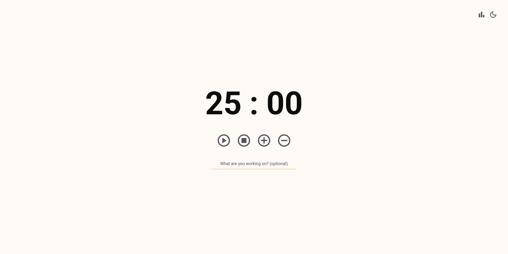
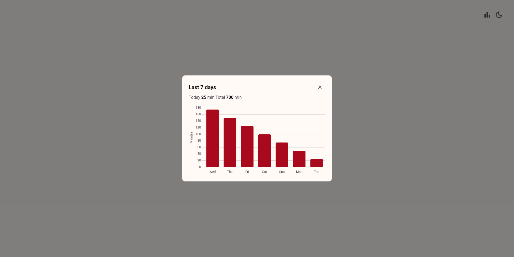
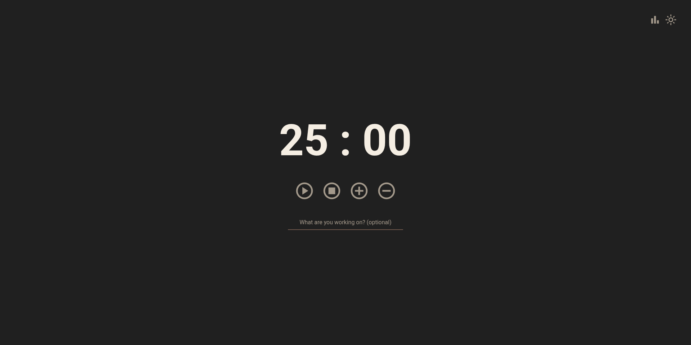
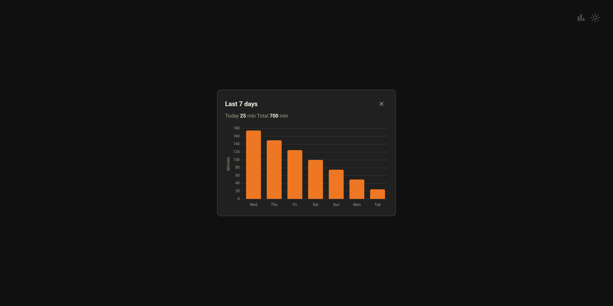

# timer

A timer with task tracking and productivity statistics.

**[demo](chiusan.github.io/timer/)**

## Screenshots







## Features

- Set any duration from 1 to 180 minutes
- Start, pause, resume, and reset
- Optional label for each session ("What are you working on?")
- Finished sessions are logged automatically
- Statistics dialog with a 7-day bar chart
- Light and dark themes (follows your choice across visits)
- Countdown shown in the browser tab title
- Accurate timing, even when the tab is in the background
- Keyboard accessible

## Tech stack

- HTML, CSS, JavaScript (ES modules, no build step)
- LocalStorage for persistence
- Deployed with GitHub Pages

## Run locally

ES modules do not work from `file://`, so use a local server:

```bash
git clone https://github.com/chiusan/timer.git
cd timer
npx serve
```

Then open the URL shown in the terminal.

## Future plans

- Presets for common methods (Pomodoro, 52/17)
- Automatic focus/break cycles
- Link sessions to a task list
- Statistics by label

## Credits

- Icons from [Material Icons](https://fonts.google.com/icons)
- [Chart.js](https://www.chartjs.org/) for the statistics chart

## License

[MIT](LICENSE)
